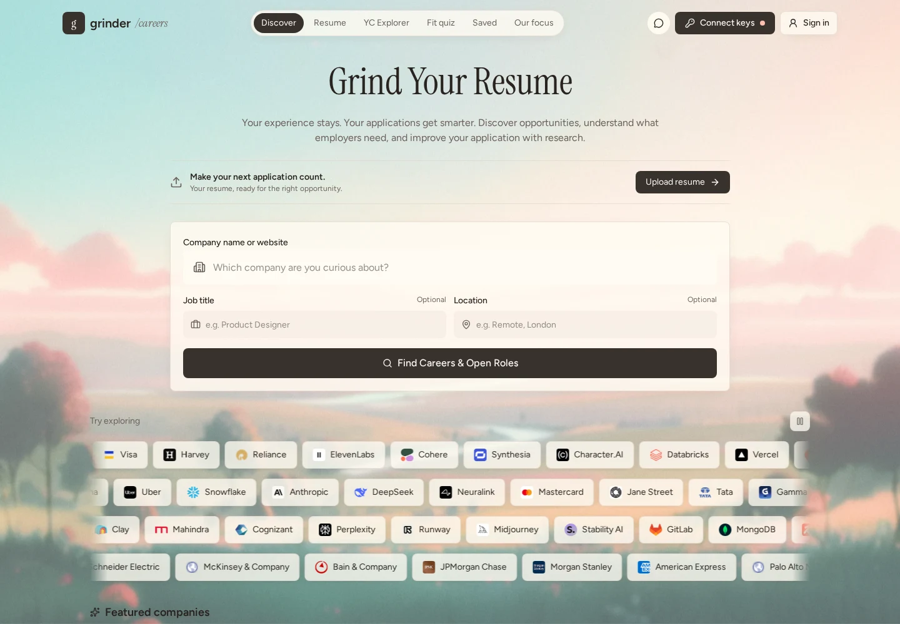
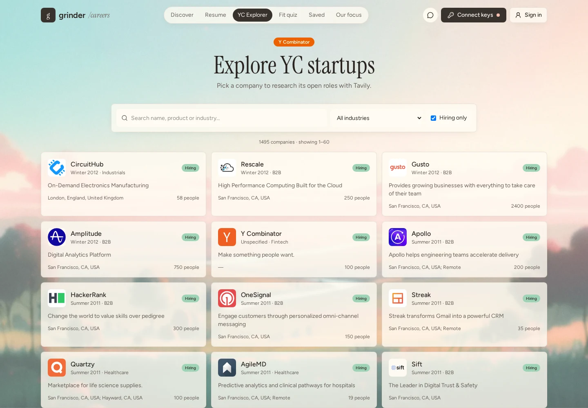
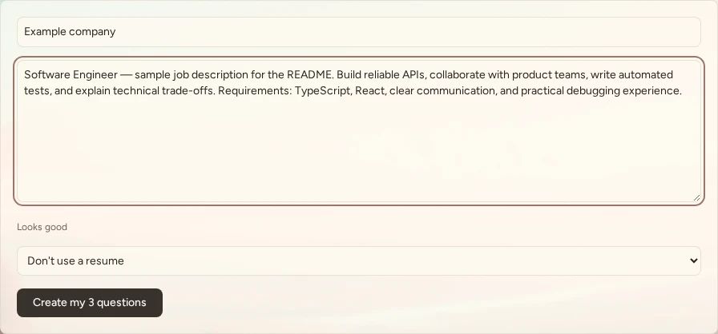
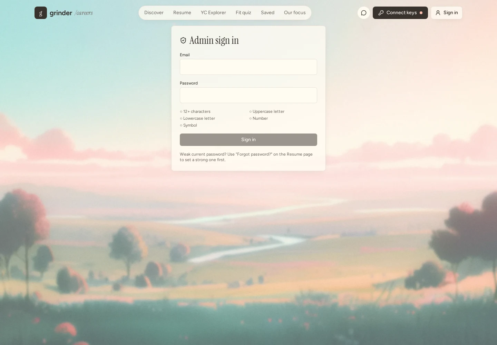

<div align="center">

# GrinderResume

### Your experience stays. Your applications get smarter.

**Company research → resume evidence → honest role fit → interview readiness**

Built for the **Nebius x NVIDIA Global AI Hackathon** · By **Maahin Panchal**

[](https://grindresume.lovable.app)
[](https://react.dev/)
[](https://www.typescriptlang.org/)
[](https://tokenfactory.nebius.com/)
[](https://tavily.com/)

[Website](https://grindresume.lovable.app) · [Features](#what-grinderresume-provides) · [Quick start](#local-setup) · [Demo walkthrough](#demo-walkthrough) · [Fine-tuning data](#nebius-fine-tuning-workflow)



</div>

> **Website status:** `grindresume.lovable.app` is the intended public address. Publishing and assigning that address are separate from this README update; the badge is not a deployment confirmation.

## Why GrinderResume?

Writing a polished application is not the same as understanding the role. Candidates often juggle a job board, a resume editor, company research, a chatbot and interview notes—and lose the connection between the job's requirements and their actual experience.

GrinderResume brings that workflow together. Discover a company, inspect its open roles, attach your saved resume, ask whether you fit, and practice answering role-specific questions **in your own words**.

The goal is not to claim that general-purpose AI cannot help with applications. It is to provide a reusable, research-grounded workspace with saved evidence, consistent document exports and a path from real interactions to a reviewable training dataset.

### Contents

- [What GrinderResume provides](#what-grinderresume-provides)
- [Portal screenshots](#portal-screenshots)
- [Demo walkthrough](#demo-walkthrough)
- [Architecture](#architecture)
- [Local setup](#local-setup)
- [Backend and administrator setup](#backend-and-administrator-setup)
- [Nebius fine-tuning workflow](#nebius-fine-tuning-workflow)
- [Data, privacy and current limits](#data-privacy-and-current-limits)
- [Development and deployment](#development-and-deployment)
- [Troubleshooting](#troubleshooting)
- [Contributing and acknowledgments](#contributing-and-acknowledgments)

## What GrinderResume provides

| Experience | What you can do |
| --- | --- |
| **Company discovery** | Search by company name or website, with optional job-title and location filters. Browse featured and confirmed community companies. |
| **YC Explorer** | Search startups by name, product or industry, filter to hiring companies, and browse 60 companies per page. |
| **Open-role research** | Read official careers pages and public Greenhouse, Ashby and Lever boards first; use Tavily research as a fallback. Availability depends on the source site. |
| **Explore role** | Send the clicked job to Career Copilot for its responsibilities, day-to-day work and requirements, rather than a generic company summary. |
| **Match my resume** | Attach a saved resume and the clicked job to Deep Research for matching evidence, a fit verdict, gaps and a practice plan. |
| **Career Copilot** | Ask follow-up questions, select a Nebius model, copy responses or download text. `@company` lets you supply up to three job links. |
| **Resume workspace** | Upload text-based PDF or DOCX files, inspect extracted text, edit structured sections, autosave privately and restore saved versions. |
| **Document templates** | Use five professional layouts with synchronized previews, font and weight controls, borders and alignment, then export PDF or Word. |
| **Cover-letter guidance** | Request a grounded draft in Copilot or prepare an editable Application Brief with a text download. There is no separate Cover Letter Studio yet. |
| **Fit quiz** | Enter a company, paste a job description and optionally select a saved resume. Answer three generated questions yourself and receive scores, strengths and gaps. No job URL extraction is needed. |
| **Saved roles** | Keep selected roles and application status in your account. |
| **Community employers** | Opt in to employer sharing and explicitly confirm each official website before publication. Private resume details are not community catalog content. |
| **Account settings** | Save and update Tavily/Nebius keys and the selected model instead of re-entering them on each sign-in. See the security caveat below. |
| **Admin console** | Authorized admins can inspect user/query totals, recent records, storage usage, JSON data and a conversational JSONL preview before download. |
| **Fine-tuning export** | Export recorded chat exchanges and submitted quiz evaluations as Nebius-compatible conversational examples. Review the data before training. |

**Fact-preserving by design:** resume suggestions require approval before changing the canonical resume. AI is instructed not to invent experience, dates, skills or results. These safeguards reduce risk; generated output still needs human review.

## Portal screenshots

These are real captures of the running portal, not mockups. Public views and a cropped signed-in quiz form are used to avoid exposing account details or resume content. The quiz contains illustrative text and was not submitted.

### YC company exploration



### Role-specific quiz setup



### Administrator entrypoint



The administrator screenshot intentionally shows the login rather than private users, queries or training records.

## Demo walkthrough

1. **Sign in:** open **Resume** and create an account or use a configured sign-in method. Complete email confirmation if required.
2. **Connect providers:** open **Connect keys**, enter your Tavily and Nebius keys, choose an available Nebius model, and save. Provider usage can incur charges.
3. **Prepare your evidence:** upload a PDF/DOCX resume, inspect the extracted source, correct any parsing mistakes, choose a template and save. Try a PDF or Word export.
4. **Find a role:** search a company on **Discover**, or select one in **YC Explorer**. Run careers research and choose an actual job listing.
5. **Understand the job:** click **Explore role**. The selected job and breakdown question are sent to Career Copilot.
6. **Evaluate your fit:** click **Match my resume** with a saved resume available. Read the evidence, gaps and practice suggestions. Follow up with: “Am I a good fit, and why this company?”
7. **Prepare an application:** ask Copilot to draft a cover letter using only verified resume facts, or use the Application Brief. Review and edit before sending.
8. **Test your own reasoning:** open **Fit quiz**, enter the company and paste at least 100 characters of job description. Select a resume if desired, generate three questions, type your own answers and submit for feedback. Pasting into answer fields is disabled, but this is not proof of authorship.
9. **Revisit your work:** check saved resumes, versions, roles and quiz records in your account.
10. **Inspect training data:** an authorized admin opens `/admin`, reviews totals and storage, then selects **Fine-tuning export (.jsonl)** to inspect examples and validation results before downloading.

## Architecture

```text
React 19 + TanStack Start + Tailwind CSS
                     |
       Authenticated application functions
          /              |              \
 Lovable Cloud      Careers research     Nebius inference
 auth + database    official sites/ATS   role explanations
 private storage    Tavily fallback      fit + quiz feedback
          \              |              /
        Saved resume facts + selected job context
                     |
     Document exports + recorded interactions
                     |
      JSONL review/export → Nebius Data Lab
```

| Layer | Implementation |
| --- | --- |
| App and routing | TanStack Start, TanStack Router, React 19, TypeScript |
| Styling | Tailwind CSS v4, shared controls, landscape shell |
| Server deployment | Vite configuration with a Cloudflare-targeted Nitro build |
| Persistence | Lovable Cloud auth, PostgreSQL tables and private file storage; SQL migrations under `drizzle/migrations` |
| Research | Official careers/ATS harvesting and Tavily APIs |
| AI | Nebius-compatible inference; a Lovable AI adapter is also present for resume assistance |
| Documents | PDF.js and Mammoth extraction; jsPDF and `docx` exports; shared resume layout logic |
| Tests | Vitest and Testing Library |

```text
src/
  routes/                  # Discover, company, resume, quiz, admin and more
  components/              # Shared shell, Copilot, editor and previews
  lib/                     # Research, assessments, document and export logic
  integrations/            # Generated auth and Cloud clients
drizzle/
  schema.ts
  migrations/              # Versioned SQL and migration metadata
docs/images/               # Privacy-safe README screenshots
```

**NVIDIA context:** this repository is presented for the Nebius x NVIDIA Global AI Hackathon. Inference is accessed through Nebius; this repo does not implement a dedicated CUDA, TensorRT or NVIDIA NIM integration, and does not require a local GPU to run the web app.

## Local setup

### 1. Prerequisites

- Git.
- [Bun](https://bun.sh/) for the committed `bun.lock`, and a current Node.js LTS release (Node 22.12+ is a safe baseline for the pinned Vite 8 toolchain).
- Access to this project's Lovable Cloud configuration for the connected app. A source clone does **not** copy backend data, users or storage.
- Tavily and Nebius accounts/keys for live research and AI. Public browsing alone does not exercise those integrations.

### 2. Clone and install

Use your actual GitHub owner or organization; the repository owner is not hardcoded here.

```bash
git clone https://github.com/<YOUR_GITHUB_OWNER>/GrinderResume.git
cd GrinderResume
bun install
```

### 3. Configure the connected backend

In a Lovable-connected workspace, use its managed Cloud configuration; do not overwrite generated client files or the managed `.env`.

For a local checkout, obtain the project's **public** client configuration through authorized project configuration and put it in an uncommitted `.env.local`:

```dotenv
VITE_SUPABASE_URL=<YOUR_PUBLIC_BACKEND_URL>
VITE_SUPABASE_PUBLISHABLE_KEY=<YOUR_PUBLIC_PUBLISHABLE_KEY>
```

These are literal environment-variable names used by the generated Cloud client. They are not private administrative credentials. Never paste an admin key into a `VITE_*` variable: Vite exposes those values to the browser.

The generated server integration also recognizes `SUPABASE_URL` and `SUPABASE_PUBLISHABLE_KEY`. Deployment-managed secrets may include `NEBIUS_API_KEY`, `TAVILY_API_KEY` and `LOVABLE_API_KEY` for adapters that support server fallbacks. The generated privileged client references `SUPABASE_SERVICE_ROLE_KEY`, but this secret is **not available for export from Lovable Cloud**; do not attempt to recover it or fabricate one.

Ordinary provider setup is through **Connect keys** after sign-in. You do not need to add a GPU configuration or put your provider keys into this README.

### 4. Run the app

```bash
bun run dev
```

Open the localhost address printed by Vite; the port can differ between local development and the Lovable preview. Sign in, connect providers and follow the demo walkthrough above.

### 5. Run checks

```bash
bun run test
bun run lint
```

Tests cover portions of document logic, company handling and routing. They do not replace live provider checks, authenticated persistence checks or deployment validation.

## Backend and administrator setup

### Connected project

Use the existing Lovable Cloud backend. It must have the application migrations applied, configured sign-in providers and a **private `resumes` storage bucket** with owner-folder access policies. Confirm your local and deployed origins are permitted for sign-in and password-reset callbacks. Enable Google through Cloud settings before advertising it as an available login method.

### Independent deployment: important prerequisite

The checked-in SQL files cover resumes, versions, application research, saved roles, community companies, keys, quiz/search records, chat interactions and admin storage/dataset functions. They are **not a complete standalone backend bootstrap**:

- `0007_admin_storage_and_dataset.sql` depends on `public.has_role`, which is not defined by the checked-in migrations.
- The admin page also calls `admin_stats`; its definition and the role bootstrap are not in the checked-in migration chain.
- The original-upload policies expect a private bucket named `resumes`; the migrations do not create that bucket.

An independent host must provision those dependencies through a reviewed backend setup before applying the affected migration and using `/admin`. Do not run `drizzle-kit push` as a shortcut: it is not a substitute for SQL policies, grants, storage or RPC definitions. `drizzle.config.ts` references `LOVABLE_DB_MIGRATION_URL` for authorized migration tooling; a source checkout alone does not provide database credentials.

### Admin access

1. Create or use a real account through the normal sign-in flow.
2. Have an authorized project owner assign its **backend-enforced admin role** using the project's trusted role-management process. Visiting `/admin` does not grant privileges.
3. Set a strong password through the password-reset flow if necessary: the admin form requires at least **12 characters**, uppercase, lowercase, a number and a symbol.
4. Open `/admin` and sign in on the same page. Non-admin accounts are denied by the protected backend functions.

There is **no public default admin email or password**. Never commit passwords, role-bypass scripts or session tokens. The password checklist is a UI gate, not evidence of a global auth password policy.

## Nebius fine-tuning workflow

### What the export contains

GrinderResume produces **Conversational JSONL**: one JSON object per line, with a `messages` array. Completed recorded chats include a system instruction, grounding context and dialogue. Submitted quizzes contribute the evaluation prompt and scored feedback.

Example structure with synthetic, non-personal content:

```jsonl
{"messages":[{"role":"system","content":"Ground every claim in verified resume and job evidence. Flag missing evidence."},{"role":"user","content":"The role requires Kubernetes. My resume lists Docker only. What is the gap?"},{"role":"assistant","content":"Docker experience is relevant, but it does not establish Kubernetes experience. Treat Kubernetes as a gap and prepare a concrete learning plan."}]}
```

### Review, export and train

1. Generate useful interactions and submit quizzes. Unsubmitted quizzes are not training examples; chats from before logging was introduced cannot be recovered by the export.
2. For your own rows, use **Export fine-tuning data** in the profile menu. This path downloads directly; the in-app preview is currently an **admin-console** feature.
3. For the admin dataset, open `/admin` → **Fine-tuning export (.jsonl)**. Review example count, byte size, validation issues and individual examples before download.
4. Review privacy, consent, factual accuracy and quality. Remove sensitive details, weak answers and duplicates; reserve a held-out evaluation set. Logging everything is not the same as curating good training data.
5. Open Nebius **Data Lab**, upload the JSONL as a **Conversational** dataset, and follow the current [Nebius fine-tuning guide](https://docs.tokenfactory.nebius.com/post-training/how-to-fine-tune). Use a supported trainable base model and review costs before starting.
6. When training completes, obtain the resulting inference model identifier. If it is available to your API key through the compatible inference endpoint, enter/select it in **Keys & Models**, then evaluate it on held-out examples before switching regular use.

Nebius also accepts Instruction, Text and Pre-tokenized formats; this app's exporter builds **Conversational only**, not all four formats. The basic validator checks JSON, message roles, text content and the presence of an assistant reply—it does not certify model compatibility or dataset quality. Uploading and launching training are manual Nebius steps; there is no one-click training integration in this repo.

### File splitting and large datasets

The exporter splits on complete JSONL lines and adds `-part1`, `-part2`, etc. when necessary. Its current threshold is **`50 × 1024³` bytes (50 GiB)**, although the UI calls it “50 GB.” If Nebius enforces a decimal 50 GB limit, reduce the threshold before uploading.

This is a browser-memory export, **not a tested 50 GB streaming pipeline**. It does not rotate stored JSON automatically as database usage grows; a single oversized example is not split. Use a streamed, paginated export and a conservative file limit for production-scale datasets, and verify current limits with Nebius.

## Data, privacy and current limits

- **Account-backed data:** structured resumes, versions, source text/original uploads, saved roles, cached application research, quiz questions/submissions, recorded searches and completed Copilot exchanges.
- **Training context:** recorded exchanges may contain resume and job context. An authorized admin dataset can contain data from multiple accounts. Obtain appropriate consent and remove personal data before external training or redistribution.
- **Access scope:** ordinary application rows and resume files use owner-scoped access policies; cross-account admin views are privileged. Do not describe user data as inaccessible to authorized admins.
- **Provider keys:** currently stored in owner-scoped account rows and browser local storage. **Application-level encryption is not implemented.** Avoid shared devices; production hardening should move key handling to a server-side encrypted secret store.
- **External services:** Tavily researches public websites; private resumes are not sent to those websites. Nebius receives the prompt/context needed for the selected AI task.
- **Chat storage vs restoration:** completed exchanges are recorded for export; that does not imply full conversation threads are restored in the UI on every device. The response Save control uses browser-local storage.
- **Storage reporting:** admin totals combine selected table relation sizes, including indexes, with uploaded-object metadata. They are not a billing meter or the full backend disk footprint.
- **JSON scope:** the admin button labeled “All data (.json)” serializes the stats response and recent-record samples, not every table or source file. The JSONL dataset uses a separate admin function for chats and submitted quizzes.
- **Extraction limits:** image-only PDFs do not have an OCR pipeline here. Protected, unavailable or client-rendered job pages can still fail; paste the description when needed.
- **Research freshness:** website availability and cached catalogs affect results. There is no guarantee that every open role is found or that every catalog hiring flag is current.
- **AI judgments:** fit feedback is guidance, not a hiring prediction, validated ATS score or guarantee of employment.

## Development and deployment

```bash
bun run dev          # Local development
bun run test         # Vitest suite
bun run test:watch   # Watch tests
bun run lint        # ESLint
bun run format      # Format repository files
bun run build       # Production build in your own local/CI environment
bun run preview     # Preview the built app where supported
```

Keep TanStack Start routing and the existing Cloudflare-targeted server configuration. This is a full-stack app, not a static-only React bundle: deployments need server functions, auth callback configuration, backend access and approved server secrets.

**Lovable workflow:** connect the project to GitHub for bidirectional source sync. Publish from the Lovable editor, then assign the available `grindresume.lovable.app` address. The README does not rename a GitHub repository or publish the app.

**Independent hosting:** configure the runtime, backend dependencies and public build-time variables before deployment. Database/storage export is separate from GitHub code export. Test the deployed sign-in, resume upload/readback, research, chat and export flows—not just the landing screen.

## Troubleshooting

| Problem | What to check |
| --- | --- |
| “No API key found” | Sign in, open Connect keys, save the relevant provider key and select a model available to that account. |
| Research returns few/no jobs | Confirm the official website, retry without restrictive title/location filters, and check provider limits. A careers homepage is not a specific job posting. |
| Resume match asks for an upload | Save or select a resume first, then retry on the intended role. |
| Upload fails | Check sign-in, private `resumes` bucket and owner policies; use a text-based PDF or DOCX. |
| Google sign-in fails | Verify Google is actually configured and the current origin/callback is allowed in Cloud settings. |
| Admin says “Admins only” | The account needs an authorized backend role; a strong password alone does not grant access. |
| Admin storage stays loading on a fresh backend | Check `has_role`, admin RPC dependencies and migration provisioning; the clone is not a complete admin bootstrap. |
| Training export is empty | Create completed recorded chats or submit quizzes. Existing unsubmitted quiz drafts do not qualify. |
| A screen appears outdated | Reload without cache and check you are viewing the expected deployment/version. |

## Contributing and acknowledgments

Read [AGENTS.md](AGENTS.md) before contributing. Keep changes focused, preserve verified resume facts and use the shared layout for previews and exports. Include reproduction steps and relevant tests with fixes. Share screenshots with sample data—not real resumes, emails, provider keys or admin records.

Presentation takes inspiration from the badge-led introduction, visual demos and clear onboarding in [Hugging Face Transformers](https://github.com/huggingface/transformers), a repository with more than 50,000 stars. This is design inspiration, not a claim about GrinderResume's stars, endorsement or affiliation.

Built with Lovable, TanStack, React, Tailwind CSS, Tavily and Nebius, alongside the open-source document libraries listed in `package.json`.

**License:** no project `LICENSE` file is currently included. Public source visibility alone does not grant an open-source license; choose and add one before inviting unrestricted reuse.
